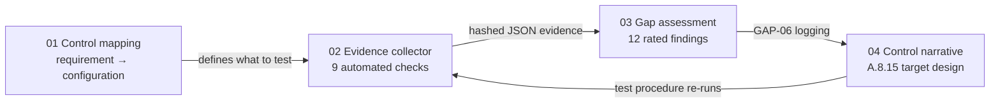

# ISO/IEC 27001:2022 GRC Engineering Portfolio

**Control mapping → automated evidence → gap assessment → control narrative, built end to end against one (fictional) company.**


## Why this repo exists

Most GRC work still runs on screenshots and spreadsheets. I wanted to show the alternative: controls defined against real configuration, evidence generated by code, and audit deliverables that trace every finding back to a hashed, re-runnable piece of evidence.

Everything here is built around **Tausi Telehealth Ltd**, a fictional Nairobi-based telehealth startup that handles patient data on AWS and wants ISO 27001 certification. Using one company means each artifact feeds the next, the same way it would on the job.

## The four artifacts

| # | Artifact | What it shows |
|---|---|---|
| 01 | [**Control mapping**](01-control-mapping) | 18 Annex A controls mapped to concrete AWS and GitHub configuration, evidence and test procedures |
| 02 | [**Evidence-collection script**](02-evidence-collection) | Python collector that tests 9 controls against AWS and writes timestamped, SHA-256-hashed JSON evidence. Runs without an AWS account using a mock environment |
| 03 | [**Mock gap assessment**](03-gap-assessment) | 12 gaps rated by likelihood × impact, split into security risk vs certification blockers, with a 90-day remediation roadmap |
| 04 | [**Control narrative**](04-control-narrative) | A.8.15 Logging written up for an auditor, with the test of design and operating effectiveness |

## How the pieces connect



The loop is the point: the mapping says what good looks like, the script measures it, the assessment prioritises what's missing, and the narrative defines the fix and how it will be tested. Then the script proves the fix.

## Try it in 30 seconds

```bash
git clone <this-repo>
cd <this-repo>/02-evidence-collection
python collect_evidence.py --mock sample_data/mock_aws_environment.json --as-of 2026-10-23
```

No dependencies or AWS account needed for mock mode. Results land in `evidence/`, with a `summary.md`, one JSON file per check and a `manifest.json` of hashes.

## Skills demonstrated

- **Framework knowledge:** ISO/IEC 27001:2022 clauses 4–10 and Annex A, including the 2022 control structure
- **Audit thinking:** test of design vs operating effectiveness, population vs sample testing, evidence integrity
- **Risk analysis:** likelihood × impact scoring and separating security risk from certification readiness
- **Engineering:** Python, boto3, unit testing, GitHub Actions, evidence as code
- **Writing:** findings and narratives written for executives, engineers and auditors

## Notes

- Tausi Telehealth, its people and its environment are fictional. The account ID is AWS's documentation example.
- ISO control descriptions are my own paraphrases, not the standard's text.
- Built by **Louisz Rigensky W.** · [LinkedIn](https://www.linkedin.com/in/louisz-rigensky-w-3b7700213) · CGE-AUD 
